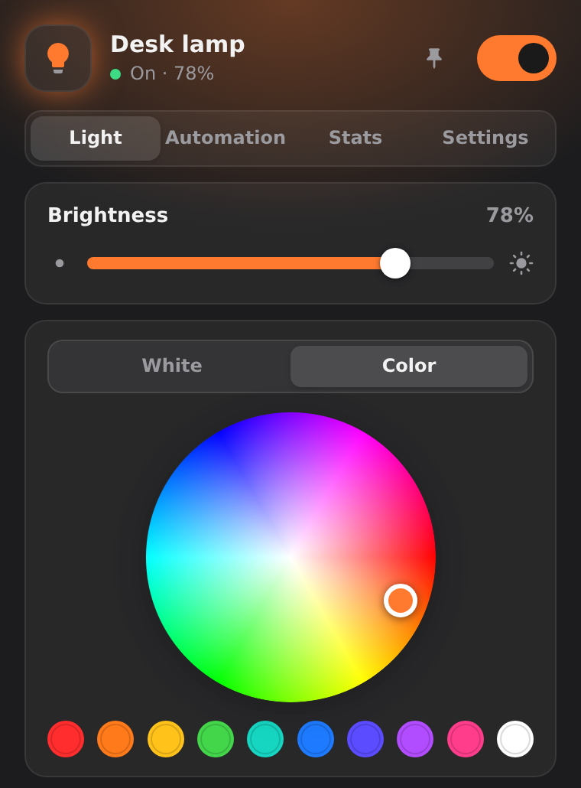
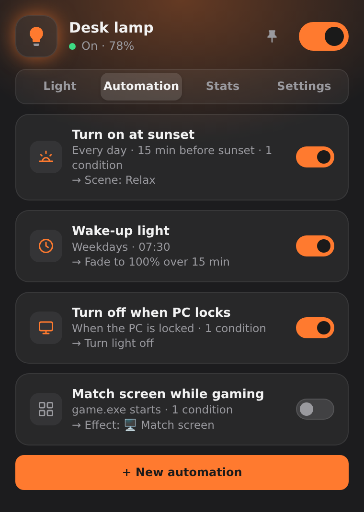
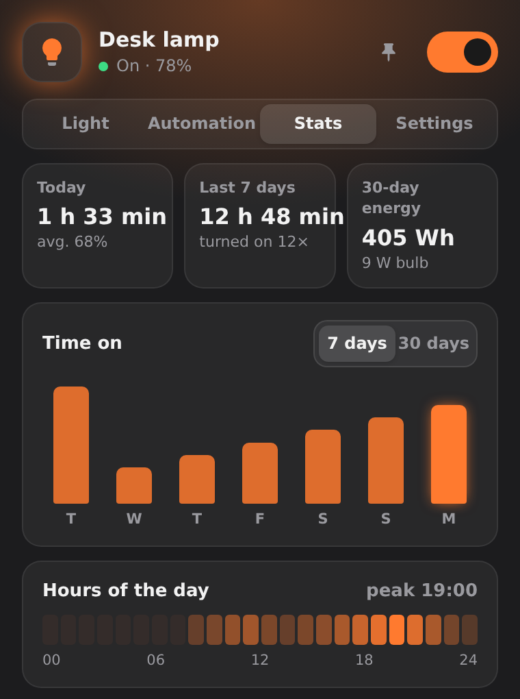
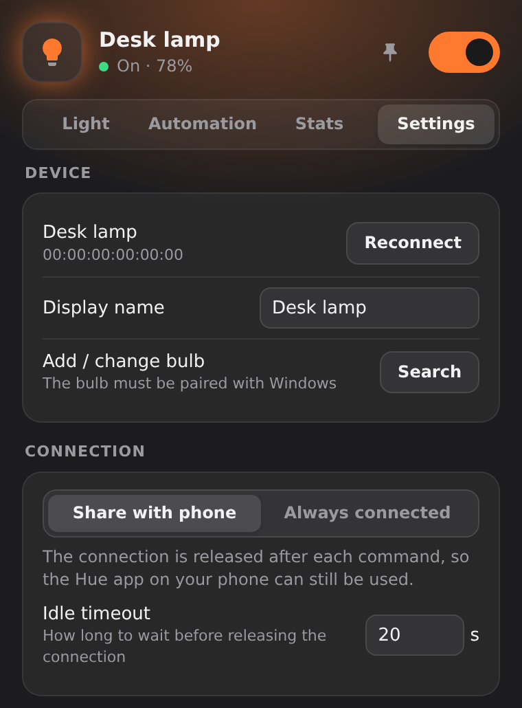

<p align="center"></p>

<h1 align="center">Glowtray</h1>

<p align="center">An independent Windows tray app for direct <b>Bluetooth</b> control of selected Philips Hue Bluetooth lights.<br>
No Hue Bridge needed (or supported). Not affiliated with Signify or Philips.</p>

<p align="center">
  <a href="#installation">Get started</a> ·
  <a href="#requirements">Requirements</a> ·
  <a href="#supported-lights">Supported lights</a> ·
  <a href="#match-screen">Match screen</a>
</p>

<p align="center">
  
  &nbsp;
  
</p>
<p align="center"><small>Light controls · Automation rules</small></p>
<p align="center">
  
  &nbsp;
  
</p>
<p align="center"><small>Usage stats · Device and connection settings</small><br>
<small>Glowtray's panel UI rendered with illustrative data; no personal settings, real bulb address or desktop are shown.</small></p>

---

Glowtray sits in your system tray as a little bulb that takes on the color of your light. Click it to open a compact
panel for brightness, white tone, color, scenes and effects. It can also automate the light based on what your PC is
doing: lock the screen and the light goes off, come back and it turns on, and at sunset it dims to a warm tone.

## Everyday controls

- **Light controls:** on/off, brightness, color temperature (2200–6500 K where supported), a color wheel and swatches
- **Scenes:** built-in presets, plus saving the current light as a new scene; also available from the tray menu
- **Sleep timer:** turn off, toggle, or fade out slowly after a set time
- Dark and light themes, optional start with Windows, and a tray icon that shows the light's current color

## Advanced features

- **Match screen:** on supported color bulbs, the light follows the dominant color and optionally the brightness of
  a display you choose. [How screen matching works](#match-screen)
- **Other effects:** candle, fireplace, breathe, color loop and party
- **Automations:** *trigger → conditions → action* rules
  - Triggers: time of day, sunrise/sunset (with an offset), PC lock/unlock, idle/back, startup, sleep/resume,
    shutdown, a program starting or exiting
  - Conditions: time range, weekdays, dark outside, light on/off, a program running, PC locked, idle time
  - Actions: on/off, scene, brightness, white tone, color, slow fade (sunrise alarm), effect, blink, Windows
    notification, f.lux sync on/off
- **f.lux sync:** the bulb follows the color temperature f.lux applies to your screen
- **Global hotkeys:** toggle the light, open the panel, and raise or lower brightness
- **Usage stats:** time on per day, hour-of-day heatmap, and an energy use and cost *estimate* based on the wattage
  you enter (not a measurement)
- **Phone-friendly connection:** by default Glowtray releases the Bluetooth connection when idle, so the Hue app on your
  phone still works (a bulb accepts only one connection at a time)

## Match screen

Select **Match screen** in the Light tab to mirror the dominant color of your chosen display on a color-capable bulb.
While the effect is active, its options in the Light tab let you choose the display and whether screen brightness
should affect the bulb. Glowtray samples a downscaled 64×36 image about four times per second, smooths the result, and
sends bulb-control commands (including power, color and brightness), not screen pixels, over Bluetooth. The image is
processed in memory; Glowtray does
not save a screen recording, upload pixels, or send screenshots to the bulb. Stop the effect to stop sampling.

This is ambient color matching, not frame-perfect video sync: transitions and Bluetooth latency will vary. The
feature needs a Hue Bluetooth light that supports color; it is not available through a Hue Bridge.[^screen]

[^screen]: Source: [`app/screen.py`](app/screen.py) and [`app/light.py`](app/light.py).

## Requirements

- Windows 10 or 11 with Bluetooth LE
- A Philips Hue light **with Bluetooth** that can be controlled directly over Bluetooth (see [Supported lights](#supported-lights))
- [Microsoft Edge WebView2 Runtime](https://developer.microsoft.com/microsoft-edge/webview2/), which is preinstalled
  on Windows 11

## Supported lights

Glowtray talks to one bulb at a time over the Hue Bluetooth GATT service. It does not use the Hue Bridge API, Zigbee,
Matter, Thread or Wi-Fi.

| Light | Status |
|---|---|
| Hue lights with Bluetooth, controlled directly | Intended target. Features depend on the model: *White* bulbs get on/off and brightness, *White Ambiance* adds white tone, *White and Color Ambiance* adds color. |
| Hue lights reachable only through a Hue Bridge (Zigbee) | Not supported |
| Bluetooth bulbs from other brands | Not supported. They use different protocols. |
| Matter, Thread or Wi-Fi bulbs | Not supported |

Glowtray has not been tested on every model or firmware version. If you try it on a bulb that isn't listed in the
issues yet, a report (working or not) helps a lot.

## Installation

1. Download `Glowtray.exe` from the [latest release](../../releases/latest) and put it anywhere, for example
   `%LOCALAPPDATA%\Programs\Glowtray\`.
2. Optionally, check that the download is intact: each release lists the SHA-256 hash of `Glowtray.exe` and a
   PowerShell command that compares it with your file.
3. Run it. Windows SmartScreen may warn you because the executable is not code-signed. Click
   *More info → Run anyway*. You can also [build it yourself](#building-the-exe) from source.
4. A bulb icon appears in the system tray. Click it to open the panel.

### Connecting your bulb

1. Make the bulb discoverable to other devices from the Hue app on your phone. In the *Hue Bluetooth* app this was
   *Settings → Voice assistants → Make lights visible*; the menu may be named or placed differently in your app
   version. Close the Hue app on your phone afterwards, because a bulb connected to a phone won't show up.
2. In Glowtray, open **Settings → Device → Search**.
3. Click **Pair** next to your bulb (or pair it in *Windows Settings → Bluetooth & devices*), then click **Use**.
4. For sunrise/sunset rules, pick your city (or enter coordinates) under **Settings → Location**. Until you do, those
   rules are paused.
5. To launch Glowtray when you sign in, turn on **Settings → Start with Windows**. It is off by default.

## Running from source

```powershell
git clone https://github.com/Tolgaugur/GlowTray.git
cd GlowTray
python -m venv .venv
.venv\Scripts\activate
pip install -r requirements.txt
python app\main.py
```

Use `python app\main.py --tray` to start hidden in the tray, which is how the autostart entry launches it.
Python 3.11 or newer is recommended.

## Building the exe

```powershell
pip install -r requirements-dev.txt
pyinstaller glowtray.spec
```

The single-file executable is written to `dist\Glowtray.exe`.

## Updating the screenshots

The screenshots at the top of this README are rendered from the real panel UI with sample data, so they never show
anyone's personal settings. After changing the UI, regenerate them with:

```powershell
python tools\screenshots.py
```

This opens `app/ui/index.html` in headless Edge (or Chromium) at the panel's size and writes the four
`docs/screenshot-*.png` files for Light, Automation, Stats and Settings. Set `GLOWTRAY_SCREENSHOT_BROWSER` to an
Edge/Chromium executable if auto-detection does not find it. These are UI renders with fixed sample data, not
captures of a running Windows/Bluetooth session; they stop at complete sections rather than cutting a card in half.

## Where data is stored

Settings, usage stats and the log file are stored in `%APPDATA%\Glowtray\`. Use *Settings → Log folder* to open it.
Glowtray has no telemetry and makes no network connections of its own. It talks only to your bulb over Bluetooth.
The log can contain your bulb's Bluetooth address and file paths with your user name, so check it before sharing it
in an issue.

## How it works

Hue Bluetooth bulbs expose a GATT service (`932c32bd-0000-47a2-835a-a8d455b859dd`) with characteristics for power,
brightness, color temperature (mireds) and color (CIE xy). Glowtray uses [bleak](https://github.com/hbldh/bleak) to
talk to them, [pywebview](https://pywebview.flowrl.com/) for the panel UI, and [pystray](https://github.com/moses-palmer/pystray)
for the tray icon.

| File | Purpose |
|---|---|
| `app/main.py` | App entry point, tray menu, panel window, and the API exposed to the UI |
| `app/light.py` | Bluetooth connection, write queue, fades and effects |
| `app/automation.py` | Rule engine and sleep timer |
| `app/sysevents.py` | Lock, sleep and shutdown events and global hotkeys (Win32) |
| `app/fluxsync.py` | Reads f.lux's gamma ramp and mirrors it on the bulb |
| `app/screen.py` | Screen capture for the *match screen* effect |
| `app/stats.py` | Usage statistics |
| `app/ui/index.html` | The whole panel UI (HTML, CSS and JS in one file) |

## Contributing

Bug reports, ideas and pull requests are welcome. See [CONTRIBUTING.md](CONTRIBUTING.md).

## Disclaimer

Glowtray is an independent project. It is not affiliated with, endorsed by, or sponsored by Signify or Philips.
"Philips" and "Hue" are trademarks of their respective owners and are used here only to describe compatible hardware.

## License

[MIT](LICENSE). The exe also bundles the Python runtime and several open-source packages, including pystray under the
LGPL v3; their licenses are listed in [THIRD_PARTY_LICENSES.md](THIRD_PARTY_LICENSES.md).
